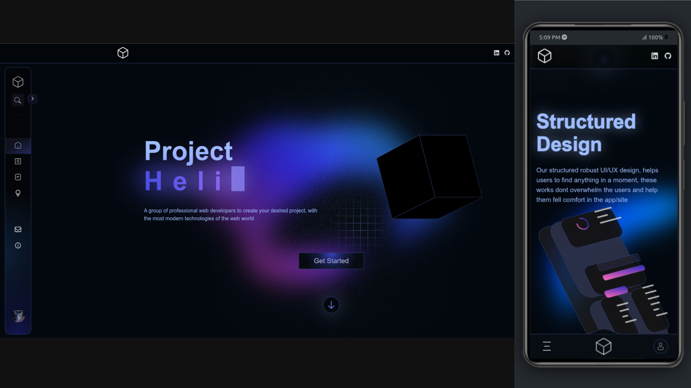

# Project Helix

## Preview

## Overview

Project Helix is a modern landing page designed to showcase advanced frontend development techniques. This project leverages CSS animations, the Web Animation API, Intersection Observer, and ViewTimeline to create a responsive and visually engaging user experience across all devices. The implementation is achieved using pure HTML, Sass, CSS, and JavaScript, without reliance on frameworks like Tailwind or Bootstrap.

## Key Features

- **Responsive Design**: Optimized for mobile, tablet, desktop, and larger screens.
  
- **Accessibility**: Efforts have been made to ensure the project is accessible to all users, adhering to best practices in semantic HTML and accessibility attributes.

- **Custom CSS Library**: Utilizes 'Beluga', a custom CSS library built with Sass (SCSS). Unused styles are purged using the PurgeCSS library. Variables can be overridden by initializing them before importing the library.

- **Widgets**: Includes pre-built JavaScript widgets imported as ES6 modules in `js/widgets.js` and corresponding styles in `css/widgets.css`. This modular approach allows for easy integration across different pages.

## Technologies Used

- **Languages**:
  - HTML: For semantic and accessible markup.
  - Sass: For advanced styling capabilities.
  - JavaScript: For interactivity and animation controls.

- **Tools**:
  - Gulp: For compiling Sass files.

- **APIs**:
  - Web Animation API
  - Intersection Observer API
  - ViewTimeline API

## Technical Skills Demonstrated

- **HTML & Accessibility**: Implementation of semantic elements and accessibility attributes to enhance user experience.
  
- **CSS Techniques**:
  - CSS Grid and Flexbox for layout management.
  - Advanced animations using CSS transforms (2D/3D).
  - CSS clip-path and mask properties for creative visual effects.

- **JavaScript Functionality**:
  - Event handling for user interactions.
  - Animation control using the Web Animation API.
  - Element visibility tracking with the Intersection Observer API.

## Usage Instructions

To view the project, open `index.html` on a local server. You can also deploy it on platforms like GitHub Pages for a live demo.

## Contact Information

For inquiries or feedback, please reach out via email at [aiparsa83@gmail.com](mailto:aiparsa83@gmail.com) or connect on [LinkedIn](https://www.linkedin.com/in/parsa-farahani-935195293).